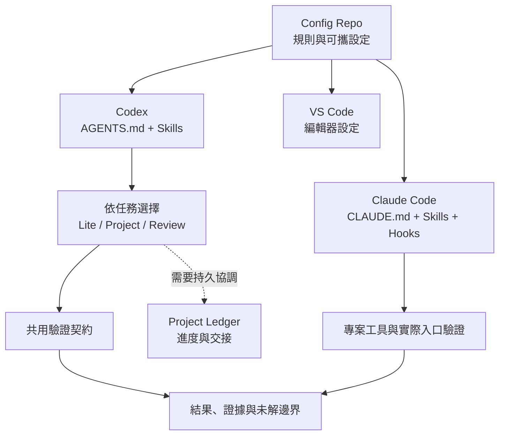
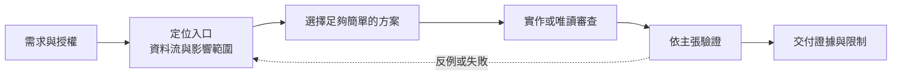

# Agent Workflow

## 架構



- **Lite**：範圍明確的修改；**Project**：需要持久進度與交接；**Review**：唯讀、問題優先。
- 保存進度與驗證強度分開：一般 Project 可用原生檢查結案；共享狀態、ownership、非同步恢復或明示契約才要求嚴格 runner。新 completion v4 保存層級決策，舊契約維持既有要求。
- 續接以明確的 session／ledger 綁定為準；同 repo 的最新紀錄只作候選，不自動接管目前任務。
- 架構、非同步收斂、互動效能等細節依風險載入，不讓每個任務承擔整份檢查表。
- Codex 與 Claude 的 8 個 skills 共用 `codex/skills/` 來源；Claude 部署時適配路徑與 hooks，兩邊的模型、工具與 ledger 分開。task-handoff 本身寫了兩邊的做法，部署時不改寫。
- 通用工程判斷集中於上述規則與 skills；重複的 `karpathy-guidelines` 不另行部署。純探索／審查子 agent 關閉 apps、plugins、memories 與權限請求工具；檔案權限仍繼承主 session，安裝及寫入驗證由主 agent 執行。

## 順序



這是判斷順序，不是固定儀式；簡單任務不因步驟數而升級流程。

## 核心工程判斷

驗證 runner 需要 Node.js、Git 與 ripgrep 可執行檔；macOS 使用 `brew install ripgrep`，非標準安裝位置可用 `VERIFICATION_RG` 指定絕對路徑。App 內附工具或 shell function 不代表其他啟動環境也能使用。

- 交代關鍵依據與必要推導，深度依問題調整，不強制固定模板。
- **降低複雜度**：增加共享狀態或抽象前，考慮更簡單的方案。
- **依契約隔離失敗**：無關資料不阻擋有效操作，但未知資料不能直接略過，也不能破壞原子性。
- **測試隨契約收斂**：驗證真實入口與可觀察結果，淘汰只綁舊實作的測試，不只持續疊加。
- **證據優先於自述**：unit、跨層、runtime、遠端 CI 各自支持不同主張；沒有測到的範圍不宣稱成功。
- **維護**：事故先查既有規則與 repo enforcement；重複或已被程式承接的規則，合併或刪除。

## 實作入口

| 想看什麼 | 入口 |
|---|---|
| 常駐協作規則 | [Codex](codex/AGENTS.md) · [Claude](claude/CLAUDE.md) |
| 架構取捨與驗證方法 | [Architecture](codex/skills/agent-core-lite/references/architecture-preflight.md) · [Verification](codex/skills/agent-core-lite/references/verification.md) |
| 長任務與交接 | [Project skill](codex/skills/agent-core-project/SKILL.md) · [Task handoff](codex/skills/task-handoff/SKILL.md)：開同名、同模型的新 task 接手，確認後封存目前 task；Claude 桌面版有 `start_session` 時同樣開新 session，沒有或來源在 worktree 裡時改在原 session 清除對話，清除後以本次交接碼請 [handoff hook](claude/hooks/resume-handoff.mjs) 帶入指定摘要 |
| UI 設計查詢與跨頁規範 | [Frontend + UI UX Pro Max](codex/skills/frontend-ui-designer/references/ui-ux-pro-max.md) |
| 規則如何演進 | [Config governance](AGENTS.md) · [介入紀錄](INTERVENTIONS.md) |
| 回合結論檢查 | [claim-check mod](claude/plugins/claim-check/hooks/register.ts)：回答送出後用次一級模型檢查結論是否超出工具證據；超出證據與矛盾在下一輪交給 Claude 查證，會影響判斷的錯誤才明確更正，屬事後校正、不是送出前攔截；不顯示給使用者，檢查沒完成時才通知 |

部署：[Codex](scripts/deploy-codex.mjs) · [Claude](scripts/deploy-claude.mjs) · [完整環境](deploy.ps1)。
Codex 設定部署只查找已安裝的 Serena，使用 `codex` context，不安裝／升級工具、不遷移其他專案；首次部署未找到 Serena 時略過該 MCP 區段。既有 `config.toml` 預設保留，設定遷移須另做精準修改與驗收，不用整份覆蓋保留模型及本機選項。Claude 的舊數值用詞 hook 已退役，部署會清理舊註冊與檔案。
檢查：[Codex validator](scripts/validate-codex.mjs) · [routing eval](scripts/run-codex-evals.mjs)。新 clone 先執行 `git config --local core.hooksPath .githooks`。Push 時，[pre-push hook](.githooks/pre-push) 會在隔離的 checkout 對每個待推的不同 commit 執行 Node 測試、validator 與 Python 測試。刪除 ref 時略過檢查。本機 Claude Code 有提供 `plugin test` 時也會執行 mod 測試，否則顯示略過原因。

Session provenance 分開記錄建立 rollout 的 CLI 與 PATH CLI；沒有獨立的當輪宿主版本證據時，`sessionRuntimeVersion` 保持空值。

Routing eval 用 `--codex-bin "/path/to/codex"` 指定實際使用的 Desktop／IDE／CLI 執行檔；未指定時解析 PATH。版本查詢與測試共用同一支執行檔，artifact 記錄其絕對路徑與版本。分數來自結構化的第一步、計畫採用的契約、授權及實際觀察到的工具事件。自由文字理由供人工閱讀。分流結果只代表計畫。

首次部署、宿主重要更新或 hook 定義變更後，執行 `node scripts/verify-codex-host.mjs`。它用本機 Codex app-server 檢查三個使用者 hook 的信任狀態，再用 localhost 模擬模型回覆，讓真正的 Codex CLI 對有效與過期證據各跑一次 Stop。若提示未信任，在 CLI 的 `/hooks` 核對定義，信任後重跑。[Codex hooks](https://developers.openai.com/codex/hooks#review-and-trust-hooks)

Claude mod 從本 repo 的 marketplace 安裝。終端機需 Claude Code 2.1.287 以上，可用 `claude --version` 確認。[Claude mods 版本需求](https://code.claude.com/docs/en/plugins/mods#turn-mods-on-or-off)

以資料夾加入的 marketplace 會直接從 repo 資料夾讀取 plugin（`claude plugin list` 的 Read from 是 repo 路徑），修改後 `/reload-plugins` 或重開 session 即生效。檢查紀錄寫在 `~/.claude/workflow/claim-check/<session>.jsonl`。

```text
claude plugin marketplace add <本 repo 路徑>
claude plugin install claim-check@agent-config
```

執行 `node scripts/claim-check-stats.mjs` 可從本機紀錄彙整耗時、模型回報的 token、轉交數、待查數、主模型核實成立數與自報更正數。另列下一則主模型回答確實出現更正原句的筆數，以及有成功工具呼叫 ID 的操作數。主模型查證後以 `record_finding` 回報 ID 和證據，稍後可為已成立的項目補記更正。外掛重新載入後會接續比對同一個 session 的下一則主模型回答，命中與未命中都會留下紀錄。0.4.0 的日誌保留已觀察到的命中；舊版沒有記錄未命中的短答，無法回推哪些更正仍在等待比對。沒有逐項 ID 的舊提醒另計。沒有紀錄時，尚無資料可評估成效。

其他機器也可用 `/plugin install claim-check --marketplace moonking60144-collab/Agent-Config` 從 GitHub 安裝。
