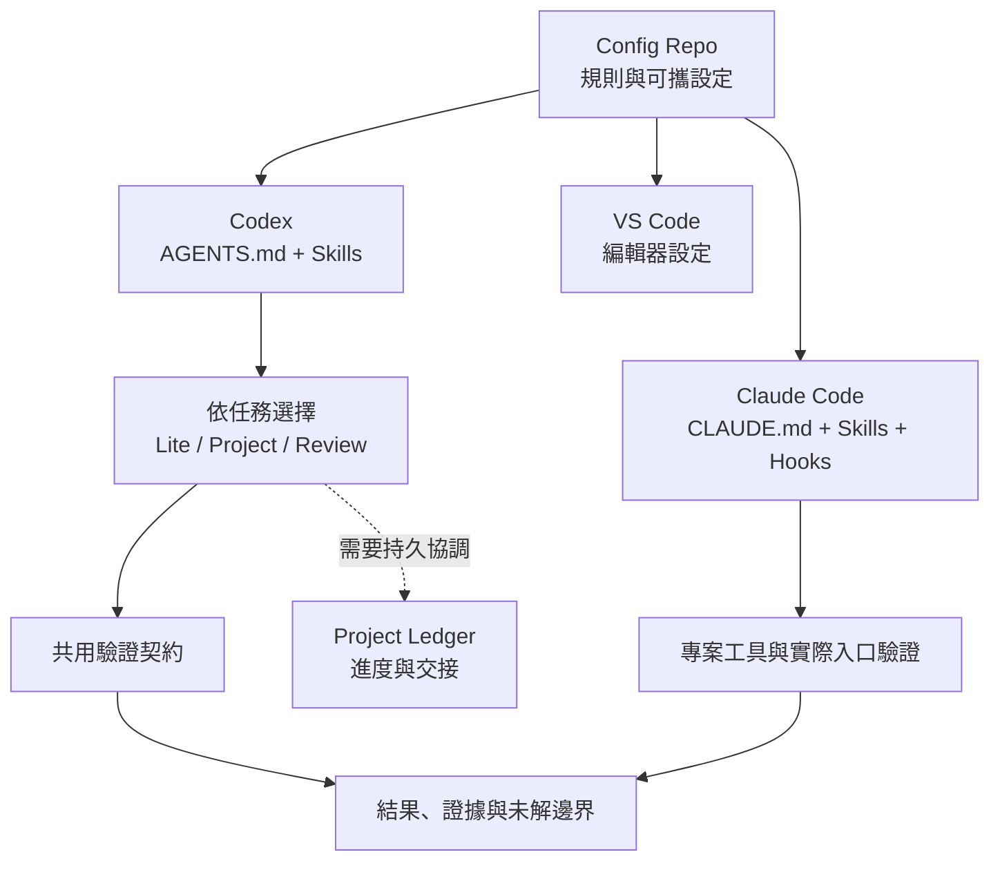
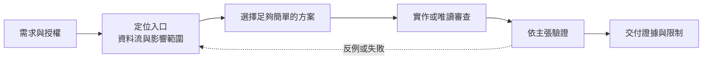

# Agent Workflow

## 架構

- **Lite**：範圍明確的修改；**Project**：需要持久進度與交接；**Review**：唯讀、問題優先。
- 架構、非同步收斂、互動效能等細節依風險載入，不讓每個任務承擔整份檢查表。
- Codex 與 Claude 的 7 個工程／設計 skills 共用 `codex/skills/` 來源；Claude 部署時適配路徑與 hooks，兩邊的模型、工具與 ledger 分開。

## 順序

這是判斷順序，不是固定儀式；簡單任務不因步驟數而升級流程。

## 核心工程判斷

驗證 runner 需要 Node.js、Git 與 ripgrep 可執行檔；macOS 使用 `brew install ripgrep`，非標準安裝位置可用 `VERIFICATION_RG` 指定絕對路徑。App 內附工具或 shell function 不代表其他啟動環境也能使用。

- 交代關鍵依據與必要推導，深度依問題調整，不強制固定模板。
- **降低複雜度**：增加共享狀態或抽象前，考慮更簡單的方案。
- **依契約隔離失敗**：無關資料不阻擋有效操作，但未知資料不能直接略過，也不能破壞原子性。
- **測試隨契約收斂**：驗證真實入口與可觀察結果，淘汰只綁舊實作的測試，不只持續疊加。
- **證據優先於自述**：unit、跨層、runtime、遠端 CI 各自支持不同主張；沒有測到的範圍不宣稱成功。
- **維護**：事故先查既有規則與 repo enforcement；重複或已被程式承接的規則，合併或刪除。

## 實作入口

| 想看什麼 | 入口 |
|---|---|
| 常駐協作規則 | [Codex](codex/AGENTS.md) · [Claude](claude/CLAUDE.md) |
| 架構取捨與驗證方法 | [Architecture](codex/skills/agent-core-lite/references/architecture-preflight.md) · [Verification](codex/skills/agent-core-lite/references/verification.md) |
| 長任務與交接 | [Project skill](codex/skills/agent-core-project/SKILL.md) |
| UI 設計查詢與跨頁規範 | [Frontend + UI UX Pro Max](codex/skills/frontend-ui-designer/references/ui-ux-pro-max.md) |
| 規則如何演進 | [Config governance](AGENTS.md) · [介入紀錄](INTERVENTIONS.md) |

部署：[Codex](scripts/deploy-codex.mjs) · [Claude](scripts/deploy-claude.mjs) · [完整環境](deploy.ps1)。
檢查：[Codex validator](scripts/validate-codex.mjs) · [routing eval](scripts/run-codex-evals.mjs)。Push 前由 [pre-push hook](.githooks/pre-push) 執行 Node 測試、validator 與 Python 測試；新 clone 先執行 `git config core.hooksPath .githooks` 啟用。
