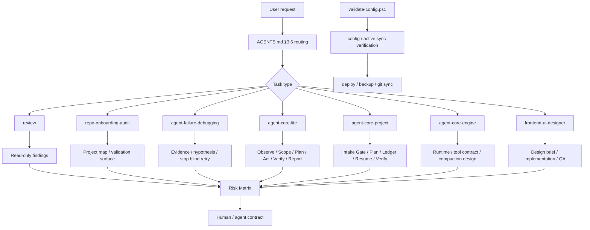

# config — 個人 Agent 與開發環境設定包

> 換新電腦 / 新公司時，clone 下來跑一個腳本，就還原我的 AI agent 行為習慣（Claude Code、Codex）與 VS Code 開發環境。

可攜的「設定」進版控；憑證、帳號狀態、機器特定路徑一律排除。**本 repo 為私人 repo。**

---

## 快速開始

Windows / macOS 都使用 PowerShell 部署；macOS 需要先安裝 PowerShell 7、Git、Node.js。

```powershell
git clone https://github.com/moonking60144-collab/config.git
cd config
pwsh -File deploy.ps1
```

Windows PowerShell 5.1 沒有 `pwsh` 時：

```powershell
powershell -ExecutionPolicy Bypass -File deploy.ps1
```

要覆蓋既有 Codex config 時：

```powershell
pwsh -File deploy.ps1 -ForceCodex
```

`deploy.ps1` 會：依目前 OS 展開路徑與 command，把設定還原到正確位置、探測本機硬體生成 `~/.claude/profile.md`、安裝 VS Code 擴充套件，並備份被覆蓋的既有檔（`*.bak.<時間戳>`）。每個目標預設保留最近 5 份備份，可用 `-BackupRetention` 調整，設為 `0` 可停用清理。Codex skill 目錄的備份會移到 `~/.codex/backups/skills/`，避免 `.bak.*` 目錄被 Codex 當成可用 skill 掃入清單。

跨平台部署目標：

| 項目 | Windows | macOS | Linux |
|------|---------|-------|-------|
| Claude / Codex | `~/.claude` / `~/.codex` | `~/.claude` / `~/.codex` | `~/.claude` / `~/.codex` |
| VS Code User | `%APPDATA%\Code\User` | `~/Library/Application Support/Code/User` | `~/.config/Code/User` |
| Claude hook | `powershell.exe ... check-traditional.ps1` | `pwsh ... check-traditional.ps1` | `pwsh ... check-traditional.ps1` |
| Context7 MCP | `npx.cmd` / `npx` | `npx` | `npx` |
| Codex terminal | `powershell` | `zsh` | `bash` |

---

## 倉庫結構

```
config/
├── .gitattributes               # 固定跨平台文字檔換行策略
├── deploy.ps1                   # 主部署：repo -> 本機
├── backup.ps1                   # 反向同步：本機 -> repo
├── scripts/
│   └── validate-config.ps1      # 檢查 repo template、active config、skill 同步與 Context7
├── claude/                      # Claude Code
│   ├── CLAUDE.md                #   可攜核心（行為準則 + 程式撰寫準則 + 語言/身份偏好）
│   ├── profile.example.md       #   機器 profile 範本（硬體/OS/工具/常用指令）
│   ├── settings.json            #   user settings（hook command 由 deploy 依 OS 展開）
│   └── hooks/
│       └── check-traditional.ps1#   Stop hook：偵測回覆含簡體字就擋下要求改繁體
├── codex/
│   ├── AGENTS.md                #   Codex user-level 全域規則
│   ├── config.toml              #   Codex CLI 可攜偏好（已剔除機器特定的 node_repl 等）
│   ├── model-catalog.json       #   Codex model catalog snapshot（預設不由 config.toml 引用）
│   ├── policies/
│   │   └── risk-matrix.md       #   高風險操作的一頁式判斷規則
│   ├── evals/
│   │   └── read-only-boundary.cases.jsonl # read-only / destructive smoke cases
│   ├── compact-prompts/         #   context compaction prompt 實驗檔
│   ├── profiles/                #   Codex profile 檔，部署到 ~/.codex/*.config.toml
│   └── skills/
│       ├── review/              #   issue-first 審查準則
│       ├── agent-core-lite/      #   日常跨檔、同步、驗證、commit/push 工作流程
│       ├── agent-core-project/   #   長任務 plan / ledger / resume 工作流程
│       ├── agent-failure-debugging/ # 重複失敗時的 capture / diagnosis / 最小恢復流程
│       ├── repo-onboarding-audit/   # 陌生 repo 的 read-only 偵查與架構盤點流程
│       ├── agent-core-engine/       # custom agent runtime / tool loop / compactor 設計準則
│       └── frontend-ui-designer/    # Product Design 取向的前端視覺、prototype 與 design QA 流程
└── vscode/
    ├── settings.json            # 合併後的 VS Code 設定（GCP 專案 ID 已佔位）
    ├── keybindings.json
    └── extensions.txt           # 目前實際安裝的擴充套件清單
```

---

## 各部分說明

### Claude Code（`claude/`）

| 檔案 | 部署目標 | 說明 |
|------|----------|------|
| `CLAUDE.md` | `~/.claude/CLAUDE.md` | user-level global memory，不論工作目錄在哪都載入 |
| `settings.json` | `~/.claude/settings.json` | 權限模式、effort 等級、Stop hook |
| `hooks/check-traditional.ps1` | `~/.claude/hooks/` | 繁體中文檢查 hook |
| （生成）`profile.md` | `~/.claude/profile.md` | deploy 探測本機硬體生成，被 `CLAUDE.md` 以 `@import` 載入 |

**CLAUDE.md 為什麼拆兩份**：行為準則 / 程式準則是跨機器的習慣（可攜）；硬體規格、OS、工具版本是機器特定的，換機器就變。所以 `CLAUDE.md` 只放可攜核心，末尾用官方 `@~/.claude/profile.md` 把機器 profile 分檔 import 進來。換機器時 deploy 會探測新機硬體重新生成 profile，不需手改規範。

> 首次啟動 Claude Code 會跳出 import 批准對話，按核准即可。

### Codex（`codex/`）

`AGENTS.md` 部署到 `~/.codex/AGENTS.md`，作為 Codex user-level 全域規範與 canonical skill routing；可攜行為規則進版控，機器特定 runtime 路徑、帳號狀態與自動生成內容不放入此檔。

`skills/` 部署到 `~/.codex/skills/`。目前 repo 管理七個 Codex skills：

| Skill | 使用時機 | 重點 |
|-------|----------|------|
| `review` | 使用者要求 review、audit、inspect、PR/diff/branch review、architecture/integration/system review | issue-first 審查，先列 bugs、回歸、安全、測試與部署風險 |
| `agent-core-lite` | 大型 repo、跨檔、3 步以上、config/runtime mismatch、sync/deploy/commit/push | 固定使用 Observe → Scope → Plan → Act → Verify → Report，避免沒有 scope、證據或停止條件就動手 |
| `agent-core-project` | 跨 3+ 可獨立驗證子系統、長任務、需要 plan/ledger/resume、或高爆炸半徑變更 | 用 Intake Gate、project plan、progress ledger、`done_verified`、`next_instruction` 保證可續接與可驗證 |
| `agent-failure-debugging` | 同一錯誤或假設失敗出現兩次、tool loop 形成、config 改了但 runtime 沒生效、輸出宣稱和實際狀態不一致 | 先記錄 task goal、最後成功步驟、失敗工具/指令、重複模式、環境假設，再分類 root cause，選最小可逆驗證動作 |
| `repo-onboarding-audit` | 進陌生 repo、開始 review/architecture audit 前缺上下文、要先盤點 stack、entry point、test surface 或 validation commands | 唯讀偵查 package manifest、framework fingerprint、entry points、top-level tree、tooling、tests、資料流、conventions、git history |
| `agent-core-engine` | 設計、實作、審查或擴充 custom agent runtime、tool loop、compactor、retry engine | 將 agent core 做成 deterministic lifecycle，並提供可複製的 TypeScript skeleton |
| `frontend-ui-designer` | 新 UI、視覺改版、prototype、URL/image-to-code、landing page、dashboard、產品畫面 polish | 先鎖定 design brief 與 visual target，沿用既有 design system，補齊互動狀態、asset fidelity、responsive 與 evidence-based design QA |

`deploy.ps1` 只同步 repo 內存在的 skill 目錄，並會把既有 `~/.codex/skills/*.bak.*` 備份移出 skill registry；`backup.ps1` 也只回寫 repo 已管理的 skill，避免把系統、外掛 cache 或備份目錄掃進版控。

#### Codex workflow 架構

目前架構刻意凍結在四層：routing、execution、verification、risk rules。除非真實重複失敗至少 2 次，且會造成檔案、git、設定、外部服務或長任務狀態損害，否則不新增 trace schema、typed ledger schema、MCP/plugin governance matrix、workflow DAG 或完整 agent framework。



風險規則維護在 `codex/policies/risk-matrix.md`，只保留 `read_only`、`local_reversible_write`、`local_destructive`、`git_shared_or_irreversible`、`external_side_effect`、`secret_bearing` 六類。Read-only 邊界與 destructive 操作的 smoke cases 維護在 `codex/evals/read-only-boundary.cases.jsonl`；目前它是人工 / 未來腳本化的 contract，不接入 `validate-config.ps1`。

`config.toml` 只保留可攜偏好（`developer_instructions`、model 選擇、sandbox/approval 策略、features、agents 等）。目前不啟用 `model_catalog_json` override，讓 Codex 使用官方 / server 端 catalog。已**剔除**機器特定 / 自動生成的內容：

- `[mcp_servers.node_repl]` — Codex 首次啟動自行生成，command 指向 `bin\<版本 hash>\node_repl.exe`，每次更新就變。
- `[marketplaces.*]` 的 local source、`[desktop.open-in-target-preferences.perPath]` 的絕對路徑。

`config.toml` 部署目標是 `~/.codex/config.toml`，**預設不覆蓋既有檔**（避免蓋掉現機的 node_repl）；要覆蓋用 `pwsh -File deploy.ps1 -ForceCodex`。`AGENTS.md` 與 repo 管理的 `skills/` 不含機器特定 runtime 路徑，部署時會先備份再覆蓋；skill 備份不放在 `~/.codex/skills/` 底下，避免重複出現在 Codex skill picker。

`config.toml` 裡的 `__NPX_COMMAND__`、`__SYSTEM_ROOT__`、`__CODEX_TERMINAL_SHELL__` 是跨平台 template token，不是實際部署值。`deploy.ps1` 會在 Windows 展開為 `npx.cmd`、`SystemRoot`、`powershell`，在 macOS 展開為 `npx`、移除 Windows-only `SystemRoot` / WSL 開關、terminal shell 用 `zsh`。

目前 repo 版 Codex 預設以 `gpt-5.5` 為主，不啟用 `model_catalog_json` override；`model-catalog.json` 只保留 Codex 內建 catalog snapshot。可攜 token 行為跟隨 active `~/.codex/config.toml`：`model_context_window = 1000000`、`model_auto_compact_token_limit` 不固定、`tool_output_token_limit = 8000`。

`profiles/compact-preserve.config.toml` 是 experimental compact prompt profile。需要測 context 壓縮摘要品質時，用 `codex --profile compact-preserve`；不要先放進全域 base config。

### VS Code（`vscode/`）

`settings.json` 是本機與舊 repo 版本「合併」後的結果（兩邊各有獨有設定，直接覆蓋會掉設定）。Gemini Code Assist / Gemini CLI companion 已從 managed extensions 與 settings 中移除；若單機臨時安裝，不要用 `backup.ps1 -IncludeExtensions` 回寫進 repo。

部署目標依 OS 決定：Windows 是 `%APPDATA%\Code\User\`，macOS 是 `~/Library/Application Support/Code/User`，Linux 是 `~/.config/Code/User`。擴充套件以 `extensions.txt` 為準逐一安裝（`code --install-extension`）。

### 驗證

部署或同步前後可執行：

```powershell
pwsh -File scripts/validate-config.ps1
```

新機器尚未部署 active 設定時可先只驗 repo：

```powershell
pwsh -File scripts/validate-config.ps1 -SkipActive
```

---

## 在某臺機器調整後同步回 repo

```powershell
pwsh -File backup.ps1
git diff          # 檢視變更
git add -A
git commit -m "更新設定"
git push
```

`backup.ps1` 會把本機的 `CLAUDE.md` / settings / hooks / Codex `AGENTS.md` / repo 管理的 Codex skills / compact prompts / profiles / VS Code 設定回寫到 repo，並自動把 hook command、GCP 專案 ID 還原成佔位符。Codex `config.toml` 只回寫可攜模型 / token 行為 key，避免把 `notify`、`projects.*`、本機絕對路徑等機器特定內容帶進 repo；`profile.md` 含機器特定內容，不自動回寫。

VS Code extensions 清單預設不回寫，避免某臺機器的臨時擴充污染 repo。確定要更新 `vscode/extensions.txt` 時才執行：

```powershell
pwsh -File backup.ps1 -IncludeExtensions
```

---

## 安全性

`.gitignore` 擋掉憑證與帳號狀態（即使誤把 `~/.claude`、`~/.codex` 複製進來也不會被提交）：

- `.credentials.json`（Claude OAuth）、`auth.json`（Codex / ChatGPT OAuth）
- `.claude.json`（email、帳號 UUID、referral code、專案歷史）
- `.env` / `*.env`、`.sandbox-secrets/`
- `claude/profile.md`（機器特定硬體 profile）

進版控的設定檔已確認無明文 API key / token。
