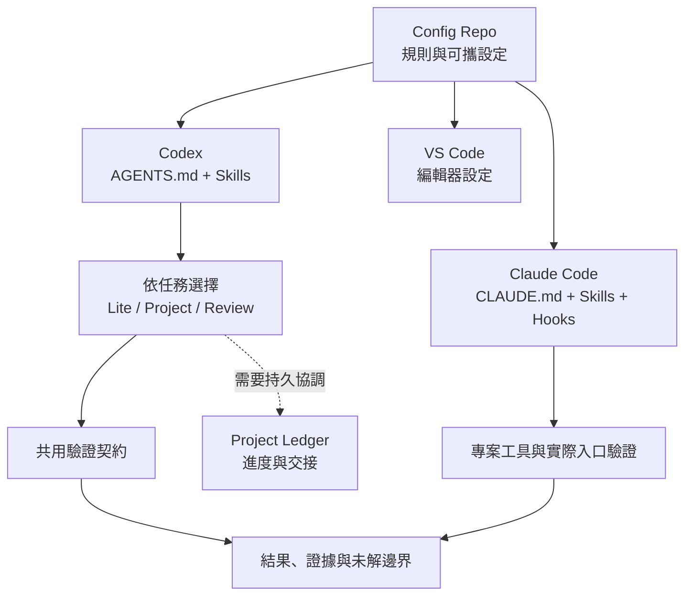

# Agent Workflow

這需要隨著模型更新，並依照專案或任務需求的結果跟著UPDATE相關SKILL描述。因為隨著傳統模型權重更新，這樣模型的相關約束也會不同，所以必須隨著迭代，此Workflow也跟著迭代，且每個人Prompt的的輸出結構也不同，模型因此產生的隨機性也無法保證。

建議按照自己的偏好經驗，客製化自己的相關AGENT-Config

## 架構



- **Lite**：範圍明確的修改；**Project**：需要持久進度與交接；**Review**：唯讀、問題優先。
- 保存進度與驗證強度分開：一般 Project 可用原生檢查結案；共享狀態、ownership、非同步恢復或明示契約才要求嚴格 runner。新 completion v4 保存層級決策，舊契約維持既有要求。
- 續接以明確的 session／ledger 綁定為準；同 repo 的最新紀錄只作候選，不自動接管目前任務。
- 架構、非同步收斂、互動效能等細節依風險載入，不讓每個任務承擔整份檢查表。
- Codex 與 Claude 的 8 個 skills 共用 `codex/skills/` 來源；Claude 部署時適配路徑與 hooks，兩邊的模型、工具與 ledger 分開。task-handoff 本身寫了兩邊的做法，部署時不改寫。
- 通用工程判斷集中於上述規則與 skills；重複的 `karpathy-guidelines` 不另行部署。純探索／審查子 agent 關閉 apps、plugins、memories 與權限請求工具；檔案權限仍繼承主 session，安裝及寫入驗證由主 agent 執行。

## 手動安裝與更新

先安裝 Git 和 Node.js。Windows 使用 PowerShell，macOS 使用終端機。

### 第一次安裝：

```sh
git clone https://github.com/moonking60144-collab/Agent-Config.git "$HOME/Agent-Config"
cd "$HOME/Agent-Config"
```

### 之後更新：

```sh
cd "$HOME/Agent-Config"
git pull --ff-only
```

### 安裝或更新成功後，在同一個視窗執行部署：

**Windows（Codex、Claude Code、VS Code）：**

```powershell
powershell.exe -NoProfile -ExecutionPolicy RemoteSigned -File .\deploy.ps1
```

**macOS（Codex、Claude Code）：**

```sh
node scripts/deploy-codex.mjs && node scripts/deploy-claude.mjs
```
